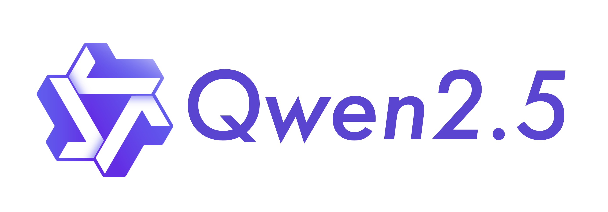
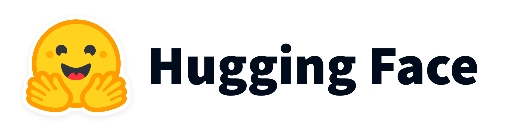
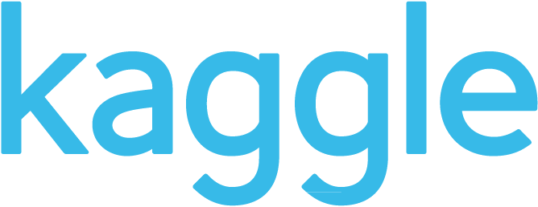
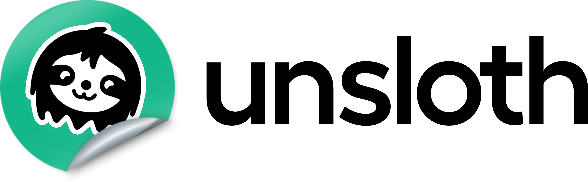
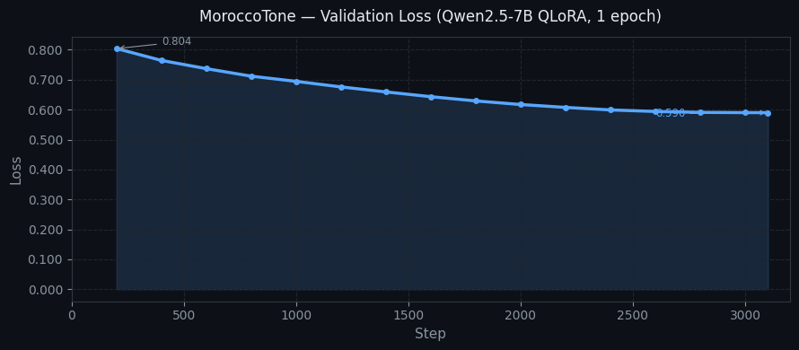

# QarnonAI — مساعد ذكي بالدارجة المغربية

<p align="center">
  
  &nbsp;&nbsp;
  
  &nbsp;&nbsp;
  
  &nbsp;&nbsp;
  
</p>

This project is a proof of concept that we can fine-tune an open LLM to better handle Moroccan Darija, code-switching (Darija + French + Arabic), and culturally appropriate communication — with limited resources.

I am not trying to build "a Moroccan LLM". The goal is more specific: adapt an existing instruction-tuned model so it behaves more naturally in a Moroccan context.

---

## What has been done so far

### 1. Dataset — DODa (Moroccan Darija lexical data)

First thing I did was get the Darija dataset from Kaggle:
https://www.kaggle.com/datasets/aymanlafaz/moroccan-darija

It has 40 CSV files covering vocabulary, conjugations, idioms, proverbs, parallel sentences, and more.

Key observations:
- `sentences.csv` + `sentences2.csv` = 3,754 real conversational Darija↔English pairs with natural code-switching
- Every vocab file has `n1/n2/n3/n4` columns = same word, multiple valid spellings (wa7d = wahd, 5rj = khrj = khraj)
- Conjugation tables: 842 verbs × 9 persons in present and past tense
- Proverbs (13 rows) and idioms (53 rows) are small but culturally rich

I converted all of this into instruction format (ChatML). Script: `convert_to_jsonl.py`

Generated **47,311 instruction examples** covering:
- Translation (Darija ↔ English)
- Spelling normalization
- Verb conjugation (present, past, imperative)
- Morphology (gender, plural)
- Idiom and proverb interpretation
- Vocabulary with variant spellings

---

### 2. Dataset — Tatoeba (Moroccan Arabic sentences)

Scraped all 101 Moroccan Arabic (`ary`) sentences from Tatoeba using their public API.
Each sentence has translations in English, French, Spanish, and Modern Standard Arabic.

Script: `scrape_tatoeba.py`

Generated **510 instruction examples** — small but high quality, CC licensed, Arabic-script Darija.

---

### 3. Dataset — Hespress comments (real Darija from the web)

Hespress is Morocco's biggest news site. The comment section is full of real Darija, French, and code-switching.

Since Hespress runs on WordPress, comments are accessible via the WordPress REST API — no JS rendering needed.

I scraped 500 articles across different topics and time periods, collected **2,473 Darija comments**, then converted them to instruction format using heuristic tasks:

- **Article reaction**: article title → Darija comment (the most natural task)
- **Text continuation**: first half of comment → second half
- **Language detection**: identify Darija / French / mixed
- **French extraction**: identify French segments in code-switched text
- **Register detection**: formal vs colloquial

Script: `scrape_hespress.py` → `convert_hespress.py`

Generated **7,319 instruction examples**

---

### 4. Final dataset

Merged all sources, shuffled, 90/10 train/val split.

Script: `build_dataset.py`

| Source | Examples |
|--------|----------|
| DODa (Darija lexical) | 47,311 |
| Hespress comments | 7,319 |
| Tatoeba ary | 510 |
| **Total** | **55,140** |

Train: 49,626 — Val: 5,514

Dataset uploaded to Kaggle:
https://www.kaggle.com/datasets/elgorrimmohamed/moroccoone-darija-instruction-dataset

---

### 5. Fine-tuning (in progress)

Model: **Qwen2.5-7B-Instruct** with **QLoRA** (4-bit, LoRA r=16)

Training on Kaggle T4 x2 using Unsloth for efficiency.

Script: `kaggle_train.py`

Config:
- Max sequence length: 512
- Batch size: 4, gradient accumulation: 4 (effective batch = 16)
- Epochs: 1
- Learning rate: 2e-4 with cosine schedule
- Optimizer: adamw_8bit
- LoRA r=16, alpha=16, dropout=0, target: q/k/v/o/gate/up/down proj

**Results (1 epoch, 3,102 steps, 8.5h on T4):**



Val loss dropped from 0.804 → 0.590 with no overfitting (val consistently below train loss throughout).

LoRA adapter: سيتم توفير نسخة النموذج الخاصة بهذا المشروع لاحقاً.

**Quick inference test:**

```
PROMPT: Translate to Darija: I don't have enough time to finish this project.
OUTPUT: makanat l7al lia ghadi n9der nkhrj had lwala2a.

PROMPT: What does this Moroccan expression mean? "راه كيدور عليك"
OUTPUT: It means: it's your turn
```

---

### 6. Evaluation

Tested on 12 held-out prompts not in the training set, across 5 categories.

| Category | Result |
|----------|--------|
| Translation (Darija ↔ English/French) | ✅ works well |
| Grammar (conjugation, morphology) | ✅ mostly correct |
| Spelling normalization | ✅ accepts valid variants |
| Cultural expressions / proverbs | ⚠️ partial — meaning sometimes imprecise |
| Code-switching generation | ⚠️ partial — defaults to pure French instead of mixed |
| Vocabulary meaning | ❌ one hallucination (bzzaf → "buzzard") |
| Language identification | ⚠️ says "Arabic" instead of "Moroccan Darija" |

Full results: `dataset/eval_results.json`

**What works:**
- Translating natural Darija sentences both directions
- Basic grammar tasks (conjugation, feminine forms, plurals)
- Spelling normalization

**What doesn't work yet:**
- Occasion-specific messages (Eid, Ramadan) — not enough training examples
- True Darija+French code-switching in output — dataset lacked enough mixed examples
- Distinguishing Darija words from French in code-switched input

These gaps are known and documented. The model is v0.1 — translation and grammar are the strong suits.

---

## Model and Dataset

This is an independent development fork based on the MoroccanLLM project.

The model and dataset links will be added after creating a new trained version.

---

## What's missing / next steps

- Occasion messages (Eid, Ramadan, weddings, condolences) — 200-500 examples
- Explicit code-switching examples with Darija+French mixed output
- More vocabulary meaning examples (current adverbs file is only 47 rows)
- Better French/Darija boundary detection training data
- Second training run after dataset improvements

- ## QarnonAI

QarnonAI is an experimental Moroccan Darija AI project designed to understand and generate Moroccan Darija, Arabic, and French.

The model will be customized for useful Moroccan applications such as information, education, and customer support.

## Project Status

This project is currently under development. A new fine-tuned model will be published after preparing the training data and completing the training process.

## Credits

This project is based on the open-source MoroccanLLM project:
https://github.com/MedGm/MoroccanLLM

